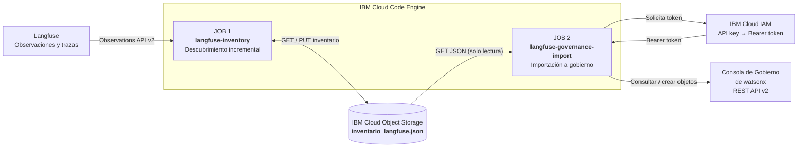
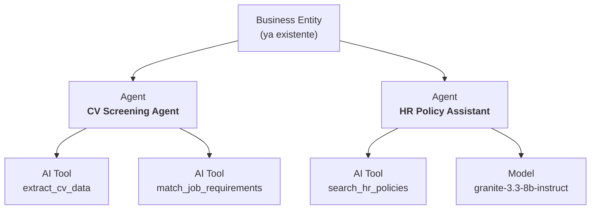

# Langfuse → Consola de Gobierno de watsonx | Job 2

**Importación incremental de agentes, herramientas y modelos desde IBM Cloud Object Storage (COS) a la Consola de Gobierno de watsonx.**

Este repositorio implementa **`langfuse-governance-import`**, el segundo Job de una demo de descubrimiento y gobierno de activos de IA. El primer Job, **`langfuse-inventory`**, ya descubre los activos observados en Langfuse y conserva un inventario JSON en COS. El segundo Job consume **ese mismo JSON**, consulta la API REST v2 de la Consola de Gobierno de watsonx y crea o reutiliza los objetos de gobierno con sus relaciones.

> [!IMPORTANT]
> El Job 2 **no consulta Langfuse directamente, no altera COS y no despliega agentes ni modelos**. Registra **objetos de gobierno** (`AIComponent`, `AITool`, `Model`) y sus asociaciones, **no activos Shadow en AI Discovery**. Esta distinción es esencial al presentar la demo.

## 1. Visión general: dos Jobs, un inventario



| Pieza | Qué hace | Estado de esta demo |
|---|---|---|
| **Job 1 · `langfuse-inventory`** | Lee observaciones de Langfuse, deduplica recursos y actualiza `inventario_langfuse.json` en COS. | Funcional, repositorio y Job independientes. |
| **COS** | Almacena el JSON compartido; es el contrato de datos entre los Jobs. | Funcional. |
| **Job 2 · `langfuse-governance-import`** | Lee el JSON, obtiene autenticación IAM y crea/reutiliza objetos asociados en gobierno. | Código de este repositorio; listo para desplegar y validar en Code Engine. |

**Por qué dos Jobs:** el descubrimiento y el gobierno tienen responsabilidades, permisos, ciclos de vida y reintentos diferentes. Se pueden lanzar manualmente en este orden: primero Job 1 para refrescar COS; después Job 2 para reflejar el inventario en la Consola de Gobierno. **No hay cron configurado**.

## 2. Recursos y relaciones que se importan

El inventario admite cinco categorías: agents, tools, knowledge bases, MCP servers y foundation models. **Esta primera versión del Job 2 importa únicamente agentes, tools y modelos**. Los otros tipos permanecen en COS para una futura ampliación.

| Recurso en el JSON | Objeto en la Consola de Gobierno | Cómo se relaciona |
|---|---|---|
| `inventory.agents[]` | **Agent** (`AIComponent`) | Se crea bajo una Business Entity u otro padre admitido existente. |
| `inventory.tools[]` | **AI Tool** (`AITool`) | Se crea bajo el Agent relacionado en el JSON. |
| `inventory.foundation_models[]` | **Model** (`Model`) | Se crea bajo el Agent relacionado en el JSON. |
| `inventory.knowledge_bases[]` | No importado | Se conserva en COS. |
| `inventory.mcp_servers[]` | No importado | Se conserva en COS. |

Ejemplo de estructura obtenida en la consola:



Las relaciones proceden de `relationships.tool_ids` / `relationships.model_ids` en cada agente y, alternativamente, de `relationships.agent_ids` en las tools y modelos. El Job no crea relaciones que el inventario no justifique.

### Qué significa «incremental»

1. Consulta los objetos existentes antes de cualquier creación.
2. Identifica cada recurso por su **ID de inventario Langfuse**, guardado como marcador en la descripción del objeto.
3. Si el objeto ya existe, lo reutiliza: **no crea duplicados**.
4. Si existe el mismo nombre pero **no** un marcador coincidente, informa de un **conflicto** en vez de vincularlo a ciegas.
5. Las tools y modelos se crean con `primary_parent_id` del Agent y se intenta verificar la asociación mediante la API.
6. Si una tool o modelo existente pertenece a otro agente, **no lo reasocia automáticamente**: informa de la discrepancia.

> [!NOTE]
> Los Resource IDs que asigna la Consola de Gobierno son distintos de los IDs del JSON de Langfuse. El importador conserva la correspondencia en las descripciones y la muestra en el informe del JobRun.

## 3. Flujo de ejecución y modos seguros

```mermaid
sequenceDiagram
    autonumber
    participant CE as Job 2 (Code Engine)
    participant COS as Cloud Object Storage
    participant IAM as IBM Cloud IAM
    participant GOV as Consola de Gobierno

    CE->>COS: GET inventario_langfuse.json
    COS-->>CE: JSON de agentes y relaciones
    Note over CE: Validar estructura y selección
    CE->>IAM: API key → access token
    IAM-->>CE: Bearer token
    CE->>GOV: Consultar tipos y objetos existentes
    GOV-->>CE: AIComponent, AITool, Model, Resource IDs
    alt IMPORT_MODE=check (predeterminado)
        Note over CE: Solo planificar y comprobar, sin POST de creación
    else IMPORT_MODE=apply
        CE->>GOV: Crear o reutilizar Agent
        GOV-->>CE: Resource ID del Agent
        CE->>GOV: Crear o reutilizar AITool y Model bajo el Agent
        CE->>GOV: Verificar asociaciones padre-hijo
    end
    Note over CE: Resumen e IDs en logs; COS no se modifica
```

| Variable de control | Comportamiento |
|---|---|
| `IMPORT_MODE=check` | **Predeterminado.** Conecta con COS y gobierno, pero no crea objetos. |
| `IMPORT_MODE=apply` | Crea los recursos que faltan, conservando relaciones. |
| `IMPORT_ONLY_AGENT=HR Policy Assistant` | Importa **solo ese agente** y todos sus componentes relacionados. |
| `IMPORT_MAX_AGENTS=1` | Importa el **primer agente** del JSON y todos sus componentes relacionados. `0` significa todos. |

**Atención:** `IMPORT_MAX_AGENTS=1` limita agentes, **no** tools/modelos. Para seleccionar un agente específico, usa `IMPORT_ONLY_AGENT` en vez de depender del orden del JSON.

## 4. Archivos del repositorio

```text
.
├── README.md                       # Arquitectura, ejemplos y despliegue
├── run_job.py                      # Job 2: GET de COS + orquestación del importador
├── importar_agentes_y_tools.py     # Lógica consolidada que ya funcionó en WSL
├── importar_agentes_openpages.py   # IBM IAM + REST API v2 + consulta/creación de Agents
├── importar_tools_openpages.py     # Inventario y relaciones de AI Tools
├── importar_modelos_openpages.py   # Inventario y relaciones de Models
├── requirements.txt               # IBM Cloud Object Storage SDK
├── Dockerfile                     # Imagen Python 3.12 de Code Engine
├── .env.example                   # Plantilla sin claves reales
├── .gitignore
├── .dockerignore
├── .ceignore
└── tests/
    ├── test_run_job.py             # Pruebas de lectura de COS y controles del Job
    └── test_importador_modelos.py  # Pruebas de importación y deduplicación simuladas
```

Se reutiliza la **lógica de importación probada previamente desde WSL**. `run_job.py` solo añade la descarga del inventario desde COS y adapta su ejecución a Code Engine.

## 5. Variables de entorno

| Variable | Obligatoria | Finalidad |
|---|---|---|
| `COS_ENDPOINT` | Sí | Endpoint HTTPS regional **accesible desde Code Engine**, por ejemplo `https://s3.eu-de.cloud-object-storage.appdomain.cloud`. |
| `COS_BUCKET` | Sí | Bucket que contiene el JSON escrito por el Job 1. |
| `COS_OBJECT_KEY` | No | `inventario_langfuse.json` por defecto. |
| `COS_SERVICE_INSTANCE_ID` | Sí | CRN / ID de instancia del servicio COS. |
| `COS_API_KEY` | **Sí, Secret** | API key con permiso de **lectura** sobre el bucket. |
| `OP_BASE_URL` | Sí | **Fixed URL** de la Consola de Gobierno SaaS, sin `/opgrc/api/v2` (el script añade la ruta). |
| `OP_API_KEY` | **Sí, Secret** | API key de IBM Cloud IAM con acceso a la Consola de Gobierno y permisos para consultar/crear objetos. |
| `OP_PRIMARY_PARENT_ID` | Para crear agentes nuevos | Resource ID de la Business Entity o padre válido en gobierno. |
| `IMPORT_MODE` | No | `check` (defecto) o `apply`. |
| `IMPORT_ONLY_AGENT` | No | Nombre exacto o ID del agente en COS. Vacío = todos. |
| `IMPORT_MAX_AGENTS` | No | Entero `0` (todos), `1` (solo el primero), etc. |

Las API keys de COS y gobierno **pueden ser diferentes**. La key de COS puede pertenecer incluso a otra cuenta si tiene acceso válido al bucket. **No se necesitan las credenciales de Langfuse en Job 2**.

> [!WARNING]
> En esta demo el acceso a COS se realiza mediante el **endpoint público regional** que ya funciona en el Job 1. No cambies automáticamente al endpoint `s3.direct...`: la conectividad puede ser diferente entre cuentas, redes y proyectos.

## 6. Guía paso a paso: GitHub → IBM Cloud Code Engine

### Paso 1 — Crear el repositorio GitHub

Nombre recomendado: **`langfuse-governance-import`**. Puedes hacerlo privado o público, pero **nunca** incluyas `.env`, API keys, respuestas con tokens ni inventarios que contengan información confidencial.

Descomprime el proyecto y sitúate en la carpeta que contiene el `Dockerfile`:

```bash
unzip langfuse-governance-import-job.zip
cd langfuse-governance-import-job
ls -la Dockerfile run_job.py README.md
```

Crea en GitHub un repositorio **vacío** llamado `langfuse-governance-import` y ejecuta:

```bash
git init
git add .
git commit -m "Add Langfuse-to-governance Code Engine job"
git branch -M main
git remote add origin https://github.com/TU_USUARIO/langfuse-governance-import.git
git push -u origin main
```

**Si el repositorio es privado**, configura el acceso Git de Code Engine mediante un *SSH Git repository secret* y usa `--build-git-repo-secret` en el build. Para una prueba inicial con un repositorio público, esto no hace falta. Revisa la documentación de Code Engine para la conexión al repositorio privado.

### Paso 2 — Seleccionar el proyecto Code Engine

Utiliza **el mismo proyecto que ya tiene el Job 1**, de modo que los dos Jobs estén visibles juntos:

```bash
ibmcloud login --sso
ibmcloud target -r eu-de
ibmcloud ce project select --name TU_PROYECTO_CODE_ENGINE
ibmcloud ce job list
```

No tienes que volver a crear la instancia ni el bucket COS: **Job 2 leerá el inventario existente**.

### Paso 3 — Crear un Secret específico para Job 2

En IBM Cloud Console: **Code Engine → tu proyecto → Secrets and configmaps → Create → Generic secret**.

Nombre: `langfuse-governance-credentials`

| Key del Secret | Valor |
|---|---|
| `COS_API_KEY` | API key de COS con acceso de lectura al JSON. |
| `OP_API_KEY` | API key de IBM Cloud IAM para la Consola de Gobierno. |

**No reutilices el Secret de Job 1 si contiene `LANGFUSE_SECRET_KEY`: Job 2 no necesita acceder a Langfuse.** Evita insertar API keys mediante `--from-literal` en el terminal para no dejarlas en el historial.

### Paso 4 — Crear el Job desde GitHub

Sustituye los valores de ejemplo por los de tu infraestructura. El Job se crea **en modo `check`** (no escribe en gobierno):

```bash
ibmcloud ce job create \
  --name langfuse-governance-import \
  --build-source https://github.com/TU_USUARIO/langfuse-governance-import \
  --env-from-secret langfuse-governance-credentials \
  --env COS_ENDPOINT=https://s3.eu-de.cloud-object-storage.appdomain.cloud \
  --env COS_BUCKET=TU_BUCKET \
  --env COS_OBJECT_KEY=inventario_langfuse.json \
  --env COS_SERVICE_INSTANCE_ID=TU_COS_RESOURCE_INSTANCE_CRN \
  --env OP_BASE_URL=https://TU_FIXED_URL_GOBIERNO \
  --env OP_PRIMARY_PARENT_ID=TU_RESOURCE_ID_BUSINESS_ENTITY \
  --env IMPORT_MODE=check \
  --wait
```

> **Repositorio privado:** agrega `--build-git-repo-secret TU_SECRET_GIT` si procede. Debes configurar ese Secret previamente en Code Engine.

Code Engine construirá la imagen a partir del `Dockerfile` y guardará la configuración del Job. **Crear el Job no equivale a ejecutar la importación**.

### Paso 5 — Primera prueba: comprobar un único agente

Recomendamos empezar con el agente que tiene tool y modelo:

```bash
ibmcloud ce jobrun submit \
  --job langfuse-governance-import \
  --name langfuse-gov-check-hr \
  --env 'IMPORT_ONLY_AGENT=HR Policy Assistant' \
  --env IMPORT_MODE=check \
  --wait

ibmcloud ce jobrun logs --jobrun langfuse-gov-check-hr
```

Resultado esperado: el Job recupera `inventario_langfuse.json`, identifica `HR Policy Assistant`, consulta los objetos de gobierno y muestra cuáles **crearía o reutilizaría**. No realiza llamadas `POST` de creación.

### Paso 6 — Crear ese agente, su tool y su modelo

Cuando el modo de comprobación termine correctamente:

```bash
ibmcloud ce jobrun submit \
  --job langfuse-governance-import \
  --name langfuse-gov-apply-hr \
  --env 'IMPORT_ONLY_AGENT=HR Policy Assistant' \
  --env IMPORT_MODE=apply \
  --wait

ibmcloud ce jobrun logs --jobrun langfuse-gov-apply-hr
```

El Job creará o reutilizará la estructura:

```text
HR Policy Assistant (Agent)
├── search_hr_policies (AI Tool)
└── granite-3.3-8b-instruct (Model)
```

Si ya existe porque lo creaste previamente con el importador WSL, **lo reconocerá por el marcador Langfuse y validará las relaciones**, sin duplicarlo.

### Paso 7 — Importar TODOS los agentes y sus componentes

Una vez validada la primera ejecución:

```bash
ibmcloud ce jobrun submit \
  --job langfuse-governance-import \
  --name langfuse-gov-apply-all \
  --env IMPORT_MODE=apply \
  --wait

ibmcloud ce jobrun logs --jobrun langfuse-gov-apply-all
```

En este comando **no** se especifica `IMPORT_ONLY_AGENT`: se procesan todos los agentes del JSON.

Para probar solo el **primer agente del JSON**, sin elegir nombre:

```bash
ibmcloud ce jobrun submit \
  --job langfuse-governance-import \
  --name langfuse-gov-apply-one \
  --env IMPORT_MODE=apply \
  --env IMPORT_MAX_AGENTS=1 \
  --wait
```

Cada vez que quieras refrescar el gobierno con nuevos activos, ejecuta primero Job 1 y después Job 2. **No se programa ninguna tarea automática**.

## 7. Pruebas locales en WSL (sin Code Engine)

Instala las dependencias en un entorno virtual (evita problemas con PEP 668):

```bash
python3 -m venv .venv
source .venv/bin/activate
python3 -m pip install -r requirements.txt
python3 -m unittest discover -s tests -v
```

Crea un `.env` local **sin subirlo a GitHub** usando `.env.example` como plantilla y cárgalo:

```bash
cp .env.example .env
# Edita .env con los valores reales y protege el archivo
chmod 600 .env
set -a
source .env
set +a
```

Prueba el flujo completo de lectura de COS + consultas de gobierno, sin crear objetos:

```bash
IMPORT_MODE=check IMPORT_ONLY_AGENT='HR Policy Assistant' python3 run_job.py
```

Para crear explícitamente ese agente desde WSL, si ya configuraste correctamente el Resource ID del padre:

```bash
IMPORT_MODE=apply IMPORT_ONLY_AGENT='HR Policy Assistant' python3 run_job.py
```

Esto es **la misma lógica** que ejecutará Code Engine.

## 8. Resultado, errores y reintentos

En cada JobRun verás en los logs:

- Bucket y clave del inventario consultado y número de agentes encontrados.
- Selección aplicada (`IMPORT_ONLY_AGENT` / `IMPORT_MAX_AGENTS`).
- Resource IDs de los agentes, tools y modelos creados o reutilizados.
- Resumen por tipo y estado (`created`, `already_exists`, `would_create` y posibles conflictos).

El importador escribe también un informe JSON **temporal** dentro del contenedor para calcular el resumen, pero **no lo sube a COS** ni a otro almacenamiento. En Code Engine, revisa los logs; al terminar el JobRun, el fichero temporal no se conserva. El inventario original de COS permanece intacto.

**Casos a vigilar:**

| Situación | Qué hacer |
|---|---|
| Error 401/403 en COS | Revisar `COS_API_KEY`, CRN, bucket y permisos de lectura. |
| `Connection timeout` al acceder a COS | Confirmar endpoint **público** y conectividad saliente desde Code Engine. |
| Error al obtener token IBM Cloud IAM | Revisar `OP_API_KEY` y su cuenta/identidad de servicio. |
| 403 en API de gobierno | Confirmar permisos para leer y crear `AIComponent`, `AITool` y `Model` bajo el padre. |
| `name_conflict` | Existe objeto con ese nombre sin marcador del mismo ID Langfuse. Revisar antes de modificar. |
| `association_mismatch` | Tool o Model existente pertenece a otro padre. No se reasocia automáticamente. |
| `association_unverified` | La API no pudo confirmar la relación. Comprobar en la interfaz. |
| Se ejecuta dos veces | Los objetos que ya tienen marcador se reutilizan; no se duplican. |

> [!CAUTION]
> Este Job **sí puede modificar la Consola de Gobierno** cuando `IMPORT_MODE=apply`. Usa primero `check`, ejecuta de forma secuencial (evita JobRuns `apply` concurrentes) y prueba contra una instancia de laboratorio. La deduplicación es una comprobación previa por identificador, **no una transacción atómica** frente a ejecuciones paralelas.

## 9. Seguridad y alcance

- **COS es solo lectura** para Job 2. Se requiere únicamente acceso al JSON, no permisos para sobrescribir el bucket.
- `OP_API_KEY` y `COS_API_KEY` se inyectan como **Code Engine Secrets**. No se incorporan a la imagen ni al repositorio.
- No se envían prompts, documentos ni trazas completas a la Consola de Gobierno. El importador crea nombres, referencias, descripciones y marcadores de inventario.
- La conexión usa HTTPS; el token IAM se solicita mediante una llamada de servidor a servidor.
- `IMPORT_MODE=check` es el valor seguro por defecto. Para crear, el JobRun debe indicar `IMPORT_MODE=apply` explícitamente.
- Las relaciones se crean con `primary_parent_id` y se verifican cuando la API permite leerlas.
- Los modelos registrados son **objetos de gobierno**, no endpoints de inferencia; las tools no son ejecutables desde la Consola.
- **No se emplea la API de AI Discovery**. Este Job no crea registros `Shadow` ni una fuente nativa de descubrimiento `Langfuse`.
- Los datos de ejemplo del README son sintéticos. **No se incluye el nombre de ningún cliente ni credenciales reales.**

## 10. Documentación oficial

- [IBM Cloud Code Engine — Jobs desde código fuente](https://cloud.ibm.com/docs/codeengine?topic=codeengine-run-job-source-code)
- [IBM Cloud Code Engine — Secrets](https://cloud.ibm.com/docs/codeengine?topic=codeengine-secret)
- [IBM Cloud Code Engine — Variables de entorno](https://cloud.ibm.com/docs/codeengine?topic=codeengine-envvar)
- [IBM Cloud Object Storage — Python SDK](https://cloud.ibm.com/docs/cloud-object-storage?topic=cloud-object-storage-python)
- [IBM Cloud Code Engine — Referencia CLI](https://cloud.ibm.com/docs/cli?topic=cli-cli)

---

**Siguiente ampliación posible:** registrar también las *knowledge bases* y los *MCP servers* inventariados en COS, una vez confirmados sus tipos de objeto y relaciones soportadas por la Consola de Gobierno.
